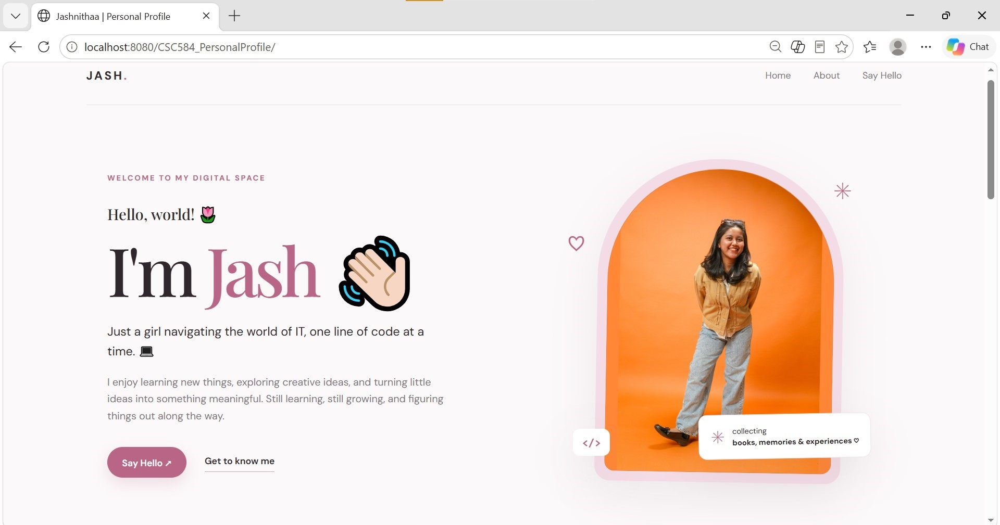
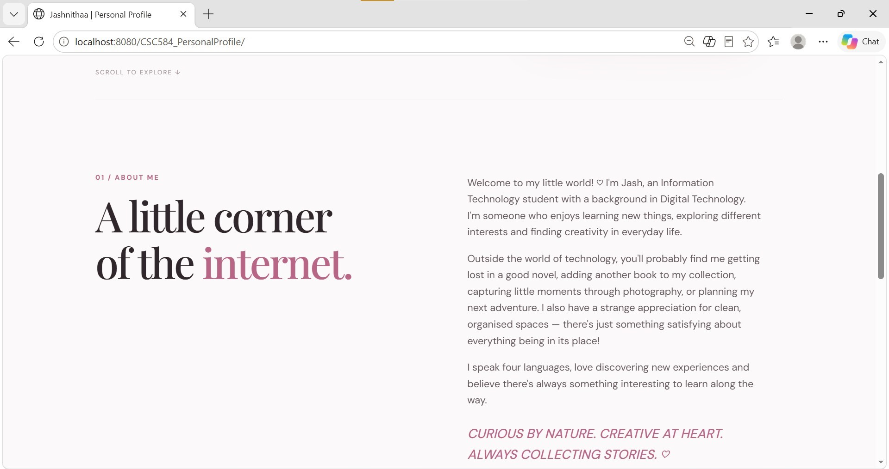
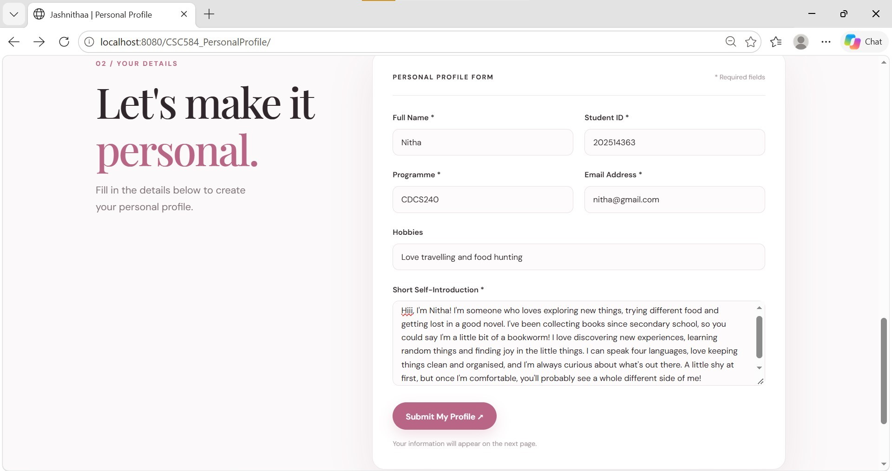
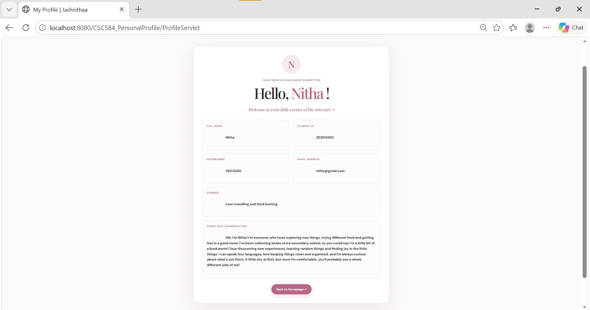

SITI JASHNITHA BINTI ABDUL AZIZ

STUDENT ID: 2025143263

CSC584 Individual Assignment 1

Personal Profile Web Application

This is a Java web application that collects personal information through an HTML form. The information is processed by a Java Servlet and displayed on a JSP profile page.

Features

- Personal profile HTML form
- HTTP POST form submission
- Java Servlet processing
- JSP profile display
- Responsive web layout
- Personalised homepage and About Me section
- Display of submitted personal information

Information Collected

- Full Name
- Student ID
- Programme
- Email Address
- Hobbies
- Short Self-Introduction

Technologies Used

- HTML5
- CSS3
- Java Servlet
- JavaServer Pages (JSP)
- NetBeans IDE

Application Flow

1. The user enters personal information in the profile form.
2. The form sends the information to ProfileServlet using HTTP POST.
3. ProfileServlet processes the submitted information.
4. The servlet forwards the information to profile.jsp.
5. profile.jsp displays the submitted personal profile.

How to Run

1. Open the project in NetBeans.
2. Configure the Tomcat server.
3. Clean and build the project.
4. Run the project.
5. Complete the personal profile form.
6. Click Submit My Profile to display the submitted information.

Screenshots

1. Homepage

2. About Me Section

3. Personal Profile Form

4. Submitted Profile Result

